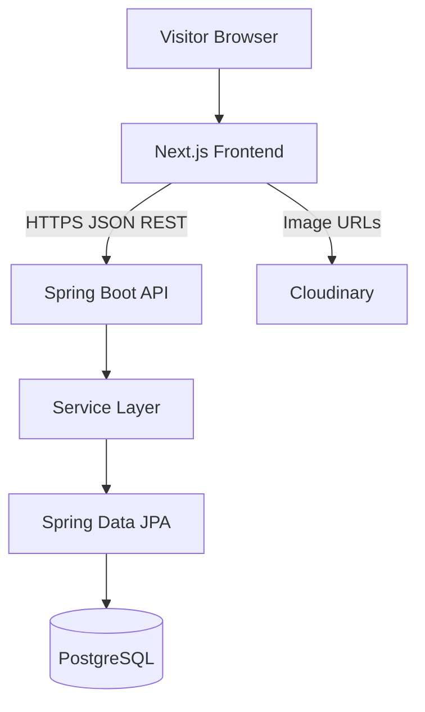

# System Architecture

## 1. High-level architecture


## 2. Frontend
- Next.js App Router and TypeScript.
- Server Components by default; Client Components for interactive search/filter controls where needed.
- Route structure: `/[locale]`, `/[locale]/recipes`, `/[locale]/recipes/[slug]`, `/[locale]/categories/[slug]`, `/[locale]/about`.
- Keep API access in service modules and shared types in `types/`.
- Use `next/image` and configured remote image domains.

## 3. Backend
Use Controller → Service → Repository.
- Controller: HTTP contract and parameter binding.
- Service: business logic and locale fallback.
- Repository: database access.
- Entity: persistence model.
- DTO: API request/response model.
- Mapper: entity/DTO conversion.
- Exception: centralized error handling.
- Config: CORS, OpenAPI and application configuration.

## 4. Suggested directory structure
```text
frontend/
  src/app/[locale]/
  src/components/{layout,recipe,category,ui}/
  src/services/
  src/types/
  src/i18n/
  src/lib/
backend/
  src/main/java/com/khmerfood/
    config/ controller/ service/ repository/
    entity/ dto/ mapper/ exception/
  src/main/resources/db/migration/
docs/
```

## 5. Technical decisions
- REST API returning JSON.
- UUID primary keys.
- Flyway owns schema migrations; use `ddl-auto: validate`.
- DTOs only at API boundaries; never serialize JPA entities directly.
- Store image URLs and optional provider identifiers, not image binaries.
- Public API returns published recipes only.
- Use pagination with a maximum page size of 50.
- Keep secrets out of source control.
