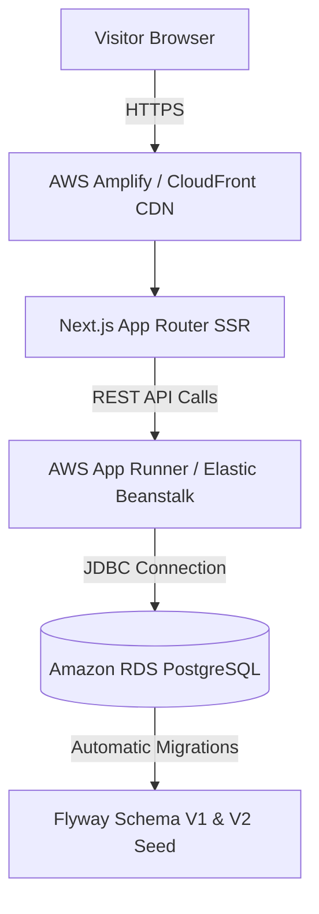

# AWS Deployment Guide for KhmerFood

This guide outlines how to deploy the KhmerFood production stack to Amazon Web Services (AWS).



---

## 1. Architecture Overview

| Component | AWS Service | Sizing / Tier | Purpose |
|---|---|---|---|
| **Database** | Amazon RDS PostgreSQL | `db.t4g.micro` or `db.t3.micro` | Managed relational database with automated backups |
| **Backend API** | AWS App Runner (or Elastic Beanstalk) | 1 vCPU, 2 GB RAM | High-availability Spring Boot REST API container |
| **Frontend** | AWS Amplify Hosting (or Vercel) | Global CDN | Next.js 14 App Router with SSR and edge caching |
| **Media/Images** | Cloudinary / Unsplash URLs | External CDN | Fast image delivery (stored as URLs in database) |

---

## 2. Step 1: Provision Amazon RDS PostgreSQL

### Via AWS Management Console:
1. Open **Amazon RDS** console and click **Create database**.
2. Select **Standard create** > **PostgreSQL** (version `16.x` or `17.x`).
3. Templates: Choose **Free tier** (or **Production**).
4. Settings:
   - DB instance identifier: `khmerfood-db`
   - Master username: `postgres`
   - Master password: *Choose a strong password (save this)*
5. Instance configuration: `db.t4g.micro` or `db.t3.micro`.
6. Storage: `20 GB gp3` with autoscaling enabled.
7. Connectivity:
   - VPC: Default VPC (or custom application VPC).
   - Public access:
     - Select **No** if backend runs in the same VPC (via VPC Connector).
     - Select **Yes** if backend runs outside VPC (ensure Security Group restricts inbound port 5432).
   - VPC security group: Create new `khmerfood-rds-sg` allowing TCP inbound on port `5432`.
8. Additional configuration:
   - Initial database name: `khmerfood_db`
9. Click **Create database**. Note down the **Endpoint** (e.g., `khmerfood-db.c123456789.us-east-1.rds.amazonaws.com`).

---

## 3. Step 2: Deploy Spring Boot Backend

### Method A: AWS App Runner (Recommended for Containers)

App Runner provides fully managed container deployment with zero server maintenance, automatic HTTPS, and automatic scaling.

#### 1. Build and Push Container to Amazon ECR
```bash
# 1. Login to Amazon ECR (replace <account-id> and <region>)
aws ecr get-login-password --region us-east-1 | docker login --username AWS --password-stdin <account-id>.dkr.ecr.us-east-1.amazonaws.com

# 2. Create ECR repository
aws ecr create-repository --repository-name khmerfood-backend --region us-east-1

# 3. Build & tag Docker image
cd backend
docker build -t khmerfood-backend .
docker tag khmerfood-backend:latest <account-id>.dkr.ecr.us-east-1.amazonaws.com/khmerfood-backend:latest

# 4. Push to ECR
docker push <account-id>.dkr.ecr.us-east-1.amazonaws.com/khmerfood-backend:latest
```

#### 2. Create App Runner Service
1. In the **AWS App Runner** console, click **Create service**.
2. Source: **Container registry** > **Amazon ECR** > select `khmerfood-backend:latest`.
3. Deployment trigger: **Automatic** (deploys on new image push).
4. Service settings:
   - Service name: `khmerfood-backend`
   - CPU: `1 vCPU`, Memory: `2 GB`
   - Port: `8080`
5. Environment Variables:
   ```env
   SPRING_PROFILES_ACTIVE=prod
   DB_URL=jdbc:postgresql://<rds-endpoint>:5432/khmerfood_db?sslmode=require
   DB_USERNAME=postgres
   DB_PASSWORD=<your-rds-password>
   CORS_ALLOWED_ORIGINS=https://<your-amplify-domain>.amplifyapp.com,http://localhost:3000
   ```
6. Networking:
   - If RDS is in private VPC: Configure an **App Runner VPC Connector** pointing to your VPC subnets and Security Group.
7. Click **Create & deploy**.
8. Once deployed, copy your service URL: `https://<random-id>.us-east-1.awsapprunner.com`.
   - Test health check: `https://<random-id>.us-east-1.awsapprunner.com/api/v1/recipes`
   - Access Swagger: `https://<random-id>.us-east-1.awsapprunner.com/swagger-ui.html`

*(Note: On first startup, Flyway automatically executes `V1__init_schema.sql` and `V2__seed_data.sql`, provisioning all tables, constraints, indexes, and initial 16 authentic recipes).*

---

### Method B: AWS Elastic Beanstalk (Direct JAR, No Docker required)

If you prefer deploying the compiled Java JAR directly without Docker:
1. Build production JAR:
   ```bash
   cd backend
   ./mvnw clean package -DskipTests
   ```
2. Open **AWS Elastic Beanstalk** > **Create application**.
3. Platform: **Java** > **Corretto 17** (Java 17).
4. Application code: Upload `backend/target/khmerfood-backend-0.0.1-SNAPSHOT.jar`.
5. Configuration > Software > Environment properties:
   - `SPRING_PROFILES_ACTIVE`: `prod`
   - `DB_URL`: `jdbc:postgresql://<rds-endpoint>:5432/khmerfood_db?sslmode=require`
   - `DB_USERNAME`: `postgres`
   - `DB_PASSWORD`: `<your-rds-password>`
   - `PORT`: `5000` (Beanstalk default Nginx proxy port)
   - `CORS_ALLOWED_ORIGINS`: `https://<frontend-domain>`
6. Click **Create app**.

---

## 4. Step 3: Deploy Next.js Frontend (AWS Amplify Hosting)

AWS Amplify Hosting provides native support for Next.js App Router (SSR, SSG, API routes, and image optimization).

1. Push your code to your GitHub / GitLab / AWS CodeCommit repository.
2. In the **AWS Amplify** console, click **New app** > **Host web app**.
3. Connect your repository and select branch `main`.
4. App directory: Specify `frontend` (since the frontend lives in `/frontend`).
5. Build settings: Amplify will auto-detect Next.js. Verify build configuration:
   ```yaml
   version: 1
   frontend:
     phases:
       preBuild:
         commands:
           - npm ci
       build:
         commands:
           - npm run build
     artifacts:
       baseDirectory: .next
       files:
         - '**/*'
     cache:
       paths:
         - node_modules/**/*
   ```
6. Environment Variables:
   Add:
   - `NEXT_PUBLIC_API_URL`: `https://<your-backend-apprunner-url>/api/v1`
   - `NEXT_PUBLIC_DEFAULT_LOCALE`: `km`
7. Click **Save and deploy**.
8. Amplify will build, provision, and deploy your site to global AWS CloudFront edge locations with an SSL certificate.

---

## 5. Security & Production Checklist

- [ ] **Database Network Isolation**: Ensure RDS security group only allows inbound traffic on port `5432` from the App Runner VPC connector / Beanstalk security group.
- [ ] **Secrets Management**: Store `DB_PASSWORD` in **AWS Secrets Manager** or **AWS Systems Manager Parameter Store** rather than plain text.
- [ ] **HTTPS/TLS**: Both AWS App Runner and AWS Amplify automatically provision free TLS certificates via AWS Certificate Manager (ACM).
- [ ] **Custom Domain Setup**:
  - Connect your custom domain (e.g. `khmerfood.com`) via Route 53 in AWS Amplify.
  - Map API subdomain (e.g. `api.khmerfood.com`) to App Runner custom domain.
- [ ] **CORS Verification**: Update `CORS_ALLOWED_ORIGINS` on the backend with your final frontend domain.
