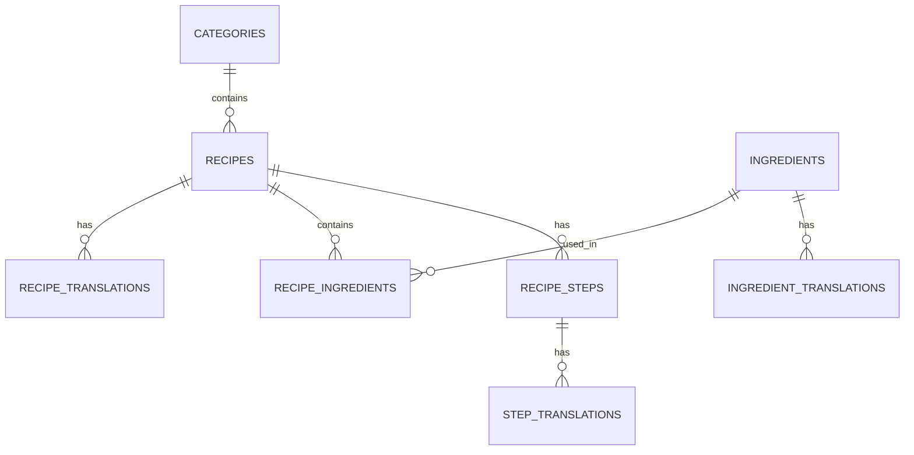

# Database Schema

Database: `khmerfood_db`. Use PostgreSQL and Flyway migrations.

## Entity relationships


## Tables
### categories
`id UUID PK`, `slug VARCHAR(100) UNIQUE NOT NULL`, `image_url TEXT`, `is_active BOOLEAN NOT NULL DEFAULT TRUE`, `created_at TIMESTAMPTZ`.

### recipes
`id UUID PK`, `category_id UUID FK`, `slug VARCHAR(150) UNIQUE NOT NULL`, `main_image_url TEXT`, `preparation_minutes INT`, `cooking_minutes INT`, `servings INT`, `difficulty VARCHAR(20)`, `status VARCHAR(20)`, `created_at TIMESTAMPTZ`, `updated_at TIMESTAMPTZ`.

### recipe_translations
`id UUID PK`, `recipe_id UUID FK ON DELETE CASCADE`, `locale VARCHAR(5) CHECK IN ('km','en')`, `name VARCHAR(200) NOT NULL`, `description TEXT`, unique `(recipe_id, locale)`.

### ingredients
`id UUID PK`, `image_url TEXT`.

### ingredient_translations
`id UUID PK`, `ingredient_id UUID FK ON DELETE CASCADE`, `locale VARCHAR(5) CHECK IN ('km','en')`, `name VARCHAR(200) NOT NULL`, unique `(ingredient_id, locale)`.

### recipe_ingredients
`id UUID PK`, `recipe_id UUID FK ON DELETE CASCADE`, `ingredient_id UUID FK`, `quantity NUMERIC(10,2)`, `unit VARCHAR(50)`, `display_order INT`, unique `(recipe_id, ingredient_id)` where appropriate.

### recipe_steps
`id UUID PK`, `recipe_id UUID FK ON DELETE CASCADE`, `step_number INT NOT NULL`, `image_url TEXT`, unique `(recipe_id, step_number)`.

### step_translations
`id UUID PK`, `step_id UUID FK ON DELETE CASCADE`, `locale VARCHAR(5) CHECK IN ('km','en')`, `instruction TEXT NOT NULL`, unique `(step_id, locale)`.

## Rules and indexes
- Use UUID primary keys and foreign keys.
- Use `CHECK` constraints for locale, difficulty and status.
- Index `recipes(category_id)`, `recipes(status)`, `recipes(created_at DESC)` and translation locale/recipe lookup.
- Use `ON DELETE CASCADE` for dependent translations and recipe steps.
- Do not delete referenced ingredients unexpectedly.
- Store image URLs, never image binary data.
- Add each schema change as a new Flyway migration; do not edit migrations already applied.

## Initial migration example
```sql
CREATE EXTENSION IF NOT EXISTS pgcrypto;

CREATE TABLE categories (
  id UUID PRIMARY KEY DEFAULT gen_random_uuid(),
  slug VARCHAR(100) UNIQUE NOT NULL,
  image_url TEXT,
  is_active BOOLEAN NOT NULL DEFAULT TRUE,
  created_at TIMESTAMPTZ NOT NULL DEFAULT CURRENT_TIMESTAMP
);

CREATE TABLE recipes (
  id UUID PRIMARY KEY DEFAULT gen_random_uuid(),
  category_id UUID NOT NULL REFERENCES categories(id),
  slug VARCHAR(150) UNIQUE NOT NULL,
  main_image_url TEXT,
  preparation_minutes INT NOT NULL DEFAULT 0 CHECK (preparation_minutes >= 0),
  cooking_minutes INT NOT NULL DEFAULT 0 CHECK (cooking_minutes >= 0),
  servings INT NOT NULL DEFAULT 1 CHECK (servings > 0),
  difficulty VARCHAR(20) NOT NULL DEFAULT 'EASY'
    CHECK (difficulty IN ('EASY','MEDIUM','HARD')),
  status VARCHAR(20) NOT NULL DEFAULT 'DRAFT'
    CHECK (status IN ('DRAFT','PUBLISHED')),
  created_at TIMESTAMPTZ NOT NULL DEFAULT CURRENT_TIMESTAMP,
  updated_at TIMESTAMPTZ NOT NULL DEFAULT CURRENT_TIMESTAMP
);

CREATE TABLE recipe_translations (
  id UUID PRIMARY KEY DEFAULT gen_random_uuid(),
  recipe_id UUID NOT NULL REFERENCES recipes(id) ON DELETE CASCADE,
  locale VARCHAR(5) NOT NULL CHECK (locale IN ('km','en')),
  name VARCHAR(200) NOT NULL,
  description TEXT,
  UNIQUE (recipe_id, locale)
);

CREATE INDEX idx_recipes_category ON recipes(category_id);
CREATE INDEX idx_recipes_status ON recipes(status);
CREATE INDEX idx_recipes_created ON recipes(created_at DESC);
```
This is only the first migration excerpt; implement all remaining tables in versioned Flyway migrations.
